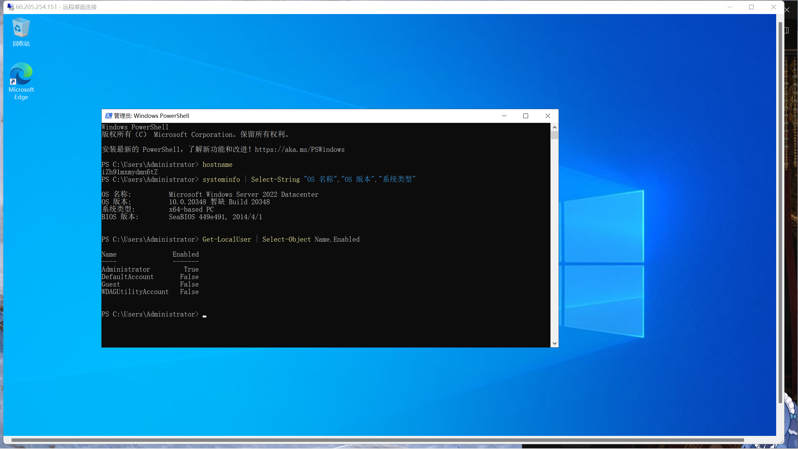
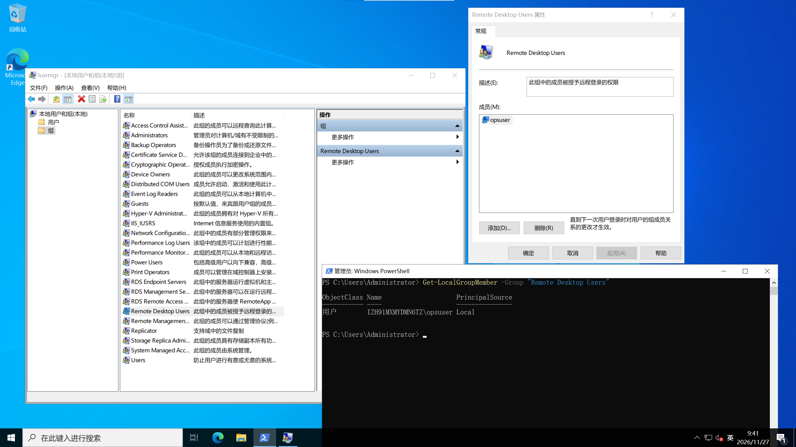
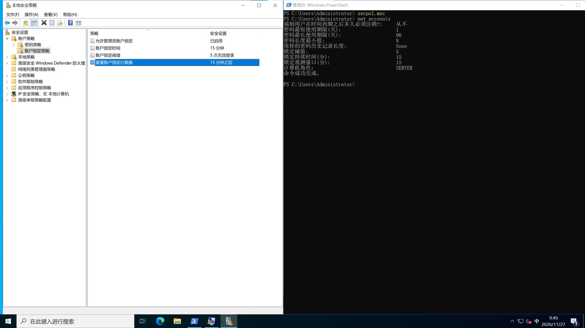
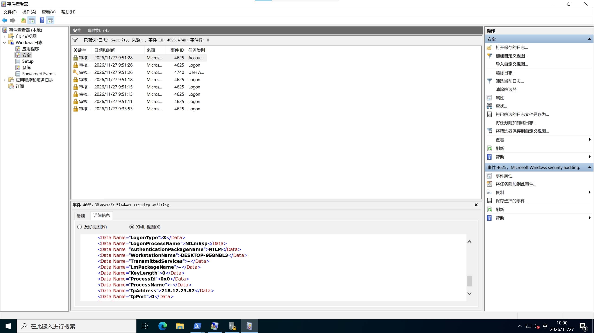

# windows/ —— Windows Server 域环境与安全基线

> 目的：把「服务器交付前要配什么」这件事在真机器上走一遍，而不是背清单。

---

## 一、环境

| 项 | 值 |
|---|---|
| 平台 | 阿里云 ECS（华北2 北京） |
| 实例 | `iZh91mxmydmn6tZ`，2 vCPU / 4 GiB，经济型 e（`ecs.e-c1m2.large`） |
| 镜像 | Windows Server 2022 数据中心版 64 位中文版（非安全加固） |
| 系统盘 | ESSD Entry 40 GiB |
| 计费 | 按量付费，约 0.3 元/小时；用完即释放 |
| 连接方式 | 公网 RDP（3389），安全组只放行本人公网 IP |

**为什么开云主机而不是本地装 VMware**：本地 4 GB 内存已经给了 Debian 实验机；云上按小时开一台，做完释放，比下载 5 GB 镜像 + 40 分钟安装划算。顺带把「云上开 Windows 并连进去」这个日常动作也练了。

---

## 二、开通时踩的三个坑

### 1. 镜像选错

第一次默认选了 **Windows Server 2022**，用于练 Linux 那套命令全部失效（`apt`、`systemctl`、`ss`、`journalctl` 都不存在）。

后来按实验目的重新开：Linux 用 Debian，Windows 用 Server——**先想清楚这台机器要练什么，再选镜像**。

### 2. 安全组默认全开

创建页默认勾了 SSH(22)、RDP(3389)、ICMP 对 `0.0.0.0/0` 开放，页面自带黄字警告：

> 22（SSH）和 3389（RDP）端口对全网开放…存在被暴力破解、入侵勒索等高风险

**整改**：RDP 来源改成 `自家公网IP/32`，SSH 与 ICMP 直接删除。

`/32` 的含义是「只允许这一个 IP」，比 `0.0.0.0/0`（任何 IP）小得多。

> 不改的后果不只是被爆破：做完的 `4625` 日志里会混进全世界扫描器的记录，**截图失去证明力**。

### 3. 没有密码

下单时「登录凭证」选了自定义密码但没填成，实例起来后无法登录。

**处置顺序（顺序不能反）**：
```
控制台「重置密码」→ 重启实例 → 等状态「运行中」→ mstsc 连接
```
**重置密码不重启不生效**。

---

## 三、连上之后第一件事：确认自己在哪台机器

第一次操作时，命令窗口开在了本地电脑（远程桌面窗口外面），跑出来的是本机信息：

```
hostname → DESKTOP-958NBL3
OsName   → Microsoft Windows 11 专业版
```

**判据：`hostname` 必须是 `iZh91mxmydmn6tZ`。**

正确做法：先点远程桌面窗口让它获得焦点 → 在**窗口内**按 `Win+R` → 输入 `powershell`。

拿到正确结果：

```powershell
hostname
systeminfo | Select-String "OS 名称","OS 版本","系统类型"
Get-LocalUser | Select-Object Name, Enabled
```

```
iZh91mxmydmn6tZ
OS 名称:   Microsoft Windows Server 2022 Datacenter
OS 版本:   10.0.20348 暂缺 Build 20348
系统类型:  x64-based PC
BIOS 版本: SeaBIOS 449e491, 2014/4/1

Administrator        True
DefaultAccount       False
Guest                False
WDAGUtilityAccount   False
```

> `SeaBIOS` 是 KVM 虚拟化的默认固件，懂行的一眼能看出这是虚拟机。
> `Administrator True` 表示内置管理员账户启用；`Guest False` 表示来宾账户已禁用，是默认的正确状态。



---

## 四、实验一：本地用户与组（最小权限模型）

**工具**：`lusrmgr.msc`

**做了什么**：
1. 新建用户 `opsuser`（密码 `Ops@2026`，勾选「用户下次登录时须更改密码」）
2. 把 `opsuser` 加入 **`Remote Desktop Users`** 组

**为什么加这个组**：`Administrators` 能改系统、装软件、看所有文件；`Remote Desktop Users` 只被授予「远程登录」这一项权限。**最小权限原则就是从这里开始的**——给运维账号只给够用的那一项，而不是图省事塞进 Administrators。

**验证组成员**：

```powershell
Get-LocalGroupMember -Group "Remote Desktop Users"
```

```
ObjectClass  Name                      PrincipalSource
用户          IZH91MXYMDMN6TZ\opsuser   Local
```

**`PrincipalSource = Local` 是关键**：表示这是本机 SAM 库里的账户，不是域账户（加域后会显示 `Active Directory`）。

**账户名前缀的含义**：

| 写法 | 含义 |
|---|---|
| `计算机名\用户名` | 本地账户（本机 SAM 数据库） |
| `域名\用户名` | 域账户（Active Directory） |

在「选择用户」对话框里点「检查名称」（`Alt+K`），系统会自动把短名补全成带前缀的全名。



---

## 五、实验二：密码策略与账户锁定（安全基线）

**工具**：`secpol.msc`（本地安全策略）

> 也可以用 `gpedit.msc`，路径是 计算机配置 → Windows 设置 → 安全设置 → 账户策略，绕得更远。`secpol.msc` 直达。

### 密码策略

| 策略 | 设置 |
|---|---|
| 密码必须符合复杂性要求 | 启用 |
| 密码长度最小值 | 8 个字符 |
| 密码最长使用期限 | 90 天 |
| 密码最短使用期限 | 1 天 |

### 账户锁定策略

| 策略 | 设置 |
|---|---|
| 账户锁定阈值 | 5 次无效登录 |
| 账户锁定时间 | 15 分钟 |
| 重置账户锁定计数器 | 15 分钟之后 |

### 验证

```powershell
net accounts
```

```
密码最长使用期限（天）:   90
密码最短使用期限（天）:    1
密码长度最小值:            8
锁定阈值:                  5
锁定持续时间（分）:       15
锁定观察窗口（分）:       15
计算机角色:             SERVER
```

> **「允许管理员账户锁定」在 Windows Server 2022 里默认是「已启用」。**
> 早年的 Windows，内置 Administrator 账户永远不会被锁定（防止把自己锁在外面）；
> 现在默认会锁，说明官方也倾向于「安全优先，管理操作自己小心」。



### 与 Linux 对照

| 目的 | Linux | Windows |
|---|---|---|
| 密码长度下限 | `/etc/login.defs` 的 `PASS_MIN_LEN` | 密码长度最小值 |
| 密码必须更换 | `PASS_MAX_DAYS 90` + `chage -M 90` | 密码最长使用期限 |
| 限制爆破 | `pam_faillock` / `pam_tally2` | 账户锁定阈值 |

**同一件事，两套系统。**等保测评「身份鉴别」条款查的就是这三项。

---

## 六、实验三：制造失败登录，再把它从日志里挖出来

### 第 0 步：先开失败审核（不能跳）

**Windows Server 默认只审核「登录成功」，不审核「登录失败」。**不开这一项，制造多少次失败登录都不会产生日志——这也是很多真实事故「查不到记录」的原因。

`secpol.msc` → 本地策略 → 审核策略 → 「审核登录事件」→ **成功 + 失败都勾上**。

> 审核策略修改后**立即生效**，不需要 `gpupdate`、不需要重启。

### 第 1 步：制造 5 次失败登录

在**本地电脑**用 `mstsc` 连 `服务器公网IP`，用户名 `opsuser`，密码故意输错 5 次。

**第 5 次之后提示语变化**：

```
由于帐户当前已被锁定，因此可能无法登录。
```

**看到这句 = 账户锁定阈值 5 生效了。**

> 绝不能拿 `Administrator` 试：锁了自己就进不去。

### 第 2 步：查日志

`eventvwr.msc` → Windows 日志 → 安全性 → 筛选当前日志，事件 ID 填 `4625,4740`。

**结果：7 条 4625 + 1 条 4740。**

| 事件 ID | 含义 |
|---|---|
| 4625 | 登录失败（每次尝试一条） |
| 4740 | 账户已被锁定 |

双击 4625 → **「详细信息」标签** → **XML 视图**，能拿到结构化字段：

```xml
<Data Name="LogonType">3</Data>
<Data Name="LogonProcessName">NtLmSsp</Data>
<Data Name="AuthenticationPackageName">NTLM</Data>
<Data Name="WorkstationName">DESKTOP-958NBL3</Data>
<Data Name="IpAddress">218.12.23.87</Data>
<Data Name="IpPort">0</Data>
```



### `LogonType` 为什么是 3 而不是 10（本文最值得记的一条）

RDP 开启 **NLA（网络级身份验证）** 后，登录分成两段：

| 阶段 | 干什么 | 日志 |
|---|---|---|
| 预认证 | 连上之前先用 NTLM 验一遍用户名密码 | 失败 → **4625，`LogonType 3`** |
| 会话建立 | 认证通过后分配桌面 | 成功 → **4624，`LogonType 10`** |

**密码错在第一段，走不到第二段，所以失败事件是 `3`（网络登录），不是 `10`（远程桌面）。**
`IpPort = 0` 也是同一原因：预认证阶段还没记录客户端端口。

**猜错过的坑**：一开始以为失败也应该是 `10`，实测才发现是 `3`。这一条书上不好找，自己打一次就记住了。

### `LogonType` 取值速查

| 值 | 类型 | 典型场景 |
|---|---|---|
| 2 | 交互式 | 坐在机器前登录 |
| 3 | 网络 | 访问共享 / NLA 预认证 |
| 10 | 远程桌面 | RDP 会话建立成功 |

### 三个字段互相印证

| 字段 | 值 | 说明 |
|---|---|---|
| `WorkstationName` | `DESKTOP-958NBL3` | 发起登录的客户端计算机名 |
| `IpAddress` | `218.12.23.87` | 客户端公网 IP |
| `AuthenticationPackageName` | `NTLM` | 走的是 NLA 预认证 |

**一个说「从哪台机器来」，一个说「从哪个 IP 来」，两条独立证据指向同一台外部主机。**

### 第 3 步：处置

`lusrmgr.msc` → 用户 → `opsuser` 属性 → 取消「帐户已锁定」；或等 15 分钟自动解锁。

---

## 七、这套流程对应真实工作

| 做的动作 | 真实工作里的名字 |
|---|---|
| 配密码策略 + 锁定阈值 | 安全基线加固 |
| 开失败审核 | 让机器留下证据 |
| 故意输错 5 次 | 攻防演练 / 验证策略 |
| 查 4625 + 4740 | 应急响应取证 |
| 解锁账户 | 处置闭环 |

---

## 八、命令与工具速查

| 用途 | 命令 / 路径 |
|---|---|
| 远程桌面客户端 | `mstsc` |
| 本机身份确认 | `hostname` / `systeminfo` / `whoami` |
| 用户与组 | `lusrmgr.msc` / `Get-LocalUser` / `Get-LocalGroupMember` |
| 本地安全策略 | `secpol.msc` |
| 组策略编辑器 | `gpedit.msc` |
| 事件查看器 | `eventvwr.msc` |
| 密码策略生效值 | `net accounts` |
| 筛选登录事件 | `4625`（失败）/ `4624`（成功）/ `4740`（锁定） |

---

## 九、费用与清理

**这台机器按小时计费，实验完必须释放。**

**释放前先确认截图已复制到本地**——上一次 Linux 实例就是释放完才发现少了一张图，只能从 OSS 里翻回来。

```
控制台 → 实例 → 更多 → 实例状态 → 释放实例
```

> **停机 ≠ 不收费**：按量付费实例停机后，系统盘、公网 IP 仍会计费。要停止计费只有释放。

---

## 十、截图索引

| 编号 | 文件 | 证明什么 |
|---|---|---|
| 01 | `01-windows-RDP连接成功.png` | RDP 连上，且是云主机（hostname / Server 2022 / Administrator 启用） |
| 02 | `02-windows-本地用户与组.png` | 建了 opsuser 并加入 Remote Desktop Users，`PrincipalSource = Local` |
| 03 | `03-windows-组策略-密码与锁定.png` | 密码策略四项 + 锁定策略三项已配，`net accounts` 验证生效 |
| 04 | `04-windows-事件日志-4625登录失败.png` | 4625/4740 事件 + `LogonType 3` + 客户端机器名 + 公网 IP |
